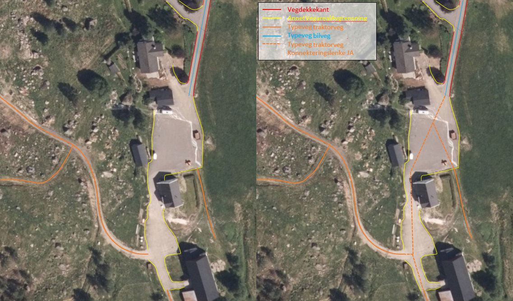
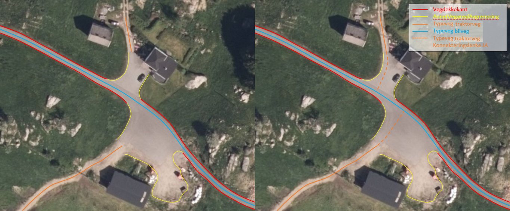
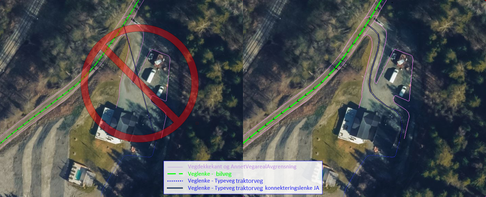
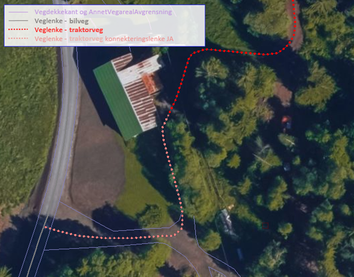
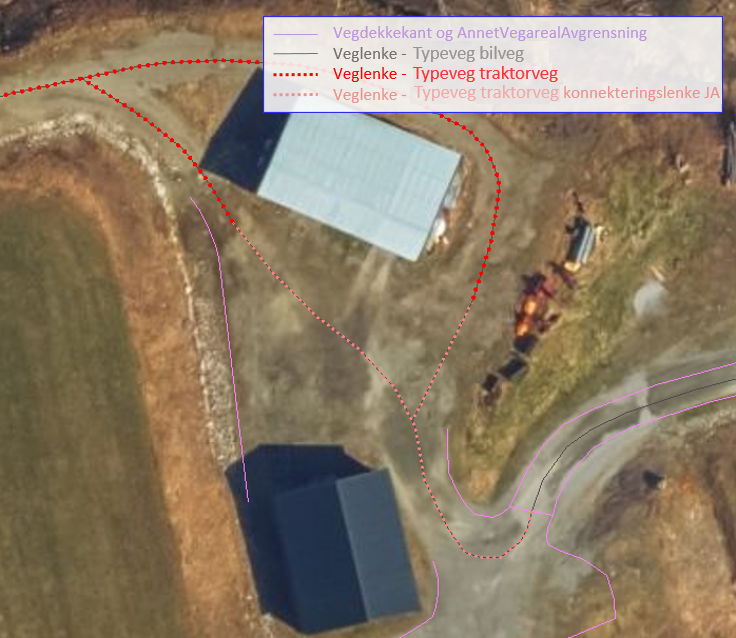
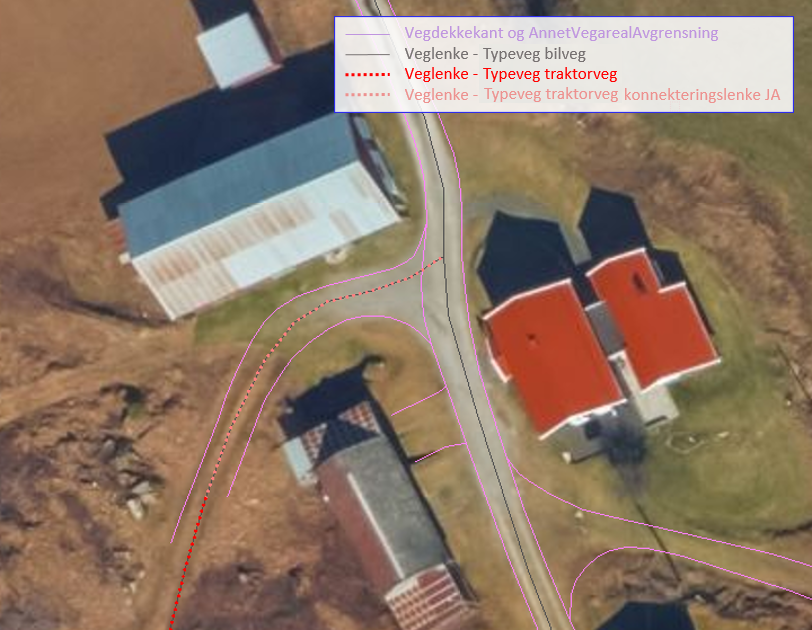
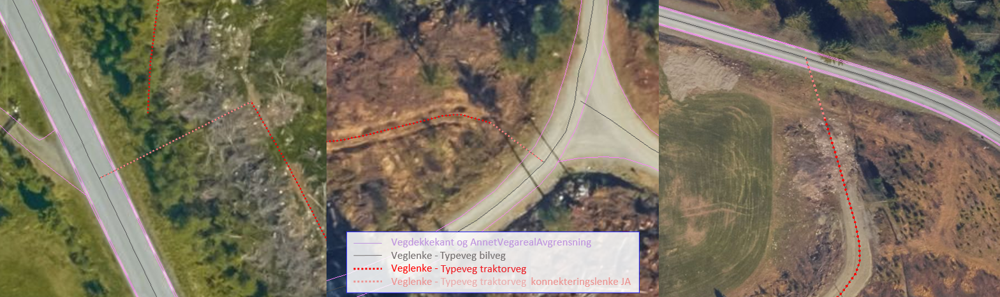

=== Prinsipp for registrering av konnekteringslenke

Veglenker i FKB-TraktorvegSti skal registreres sammenhengende over åpne plasser internt i datasettet og i overganger mellom FKB-TraktorvegSti og NVDB Vegnett. Egenskapen konnekteringslenke ja brukes for å angi at veglenken beskriver opplagte forbindelser over åpne plasser. Hensikten med egenskapen er å legge til rette for god teknisk sammenheng i datasettet samtidig med mulighet for bortfiltrering av disse lenkene ved uttegning i karttjenester.
Konnekteringslenker skal registreres og ajourføres fotogrammetrisk etter følgende prinsipper:

1)	 Veglenker i FKB-TraktorvegSti skal registreres sammenhengende over åpne plasser internt i datasettet og i overganger mellom FKB-TraktorvegSti og NVDB Vegnett.

2)	 Konnekteringslenke ja skal angis når veglenke beskriver trase over åpen plass som er kartlagt med OBJTYPE AnnetVegarealAvgrensning i FKB-Veg (se bildeeksempler under).

3)	 Eksisterende veglenker med konnekteringslenke ja skal bare slettes dersom veglenka den skaper forbindelse til også slettes

4)	 Eksisterende veglenker med konnekteringslenke ja skal geometriforbedres dersom tilstøtende veglenker geometriforbedres

Betingelse: Egenskapen skal angis for veglenker som er konnekteringslenker

Det presiseres at konnekteringslenkene skal registreres over åpne plasser som en naturlig kobling mellom traktorveg/sti og veg. Forløpet skal følge andre samferdselsobjekter. Eventuell usikkerhet i forløpet skal fremgå av kvalitetskodingen.
Konnekteringslenker kan også registreres der eksisterende AnnetVegarealAvgrensning representerer begynnelsen av traktorvegen/stien fra selve vegen.

Konnekteringslenker registreres kun ved nyregistrering eller endring på eksisterende veglenker. Utover dette må registrering av konnekteringslenker mellom eksisterende data (uten endringer) bestilles spesielt i prosjektet.

Under følger noen bildeeksempler som viser hvordan konnekteringslenker skal registreres i TraktorvegSti når traktorveg eller sti skal knyttes sammen mot veglenker i NVDB Vegnett.

.Eksempel på bruk av konnekteringslenke over gardstun i FKB-TraktorvegSti. Konnekteringslenker skal registreres fotogrammetrisk.

.Eksempel på bruk av konnekteringslenke over gardstun i FKB-TraktorvegSti. Konnekteringslenker skal registreres fotogrammetrisk.

.Et eksempel på feil (til venstre) og riktig (til høyre) registrering av en konnekteringslenke over åpent areal (avgrenset med AnnetVegarealAvgrensning) for å knytte sammen Typeveg bilveg og Typeveg traktorveg. Konnekteringslenken skal følge rutens naturlige forløp og usikkert forløp oppgis gjennom kvalitetskodingen.

.Et eksempel på hvordan en konnekteringslenke knytter sammen Typeveg bilveg og Typeveg traktorveg med et naturlig forløp over "åpent areal" sammen med AnnetVegarealAvgrensning.

.Et eksempel på hvordan to konnekteringslenker knytter sammen Typeveg bilveg og Typeveg traktorveg med et naturlig forløp over åpent areal.

.Et eksempel på hvordan en konnekteringslenke knytter sammen Typeveg bilveg og Typeveg traktorveg med et naturlig forløp over åpent areal.

Vi viser også til noen eksempler der det IKKE skal etableres konnekteringslenke. Det er typisk der det ikke er åpne arealer mellom lenkene eller fysiske hindringer (for eksempel grøfter) som gjør ferdsel mellom veglenkene unaturlig eller umulig.

.Tre eksempler der det IKKE skal etableres konnekteringslenker. Til venstre er det ikke naturlig/logisk å ha konnekteringslenke mellom sti til høyre og veg (mer naturlig mellom sti til venstre og veg). I midten er det en veggrøft/skråning mellom sti og veg. Til høyre er det ikke naturlig/logisk med konnekteringslenke grunnet grus/steinhaug mellom traktorveg (under bygging?) og veg. I alle eksemplene mangler vi også åpne plasser eller AnnetVegarealAvgrensning i bildene.

